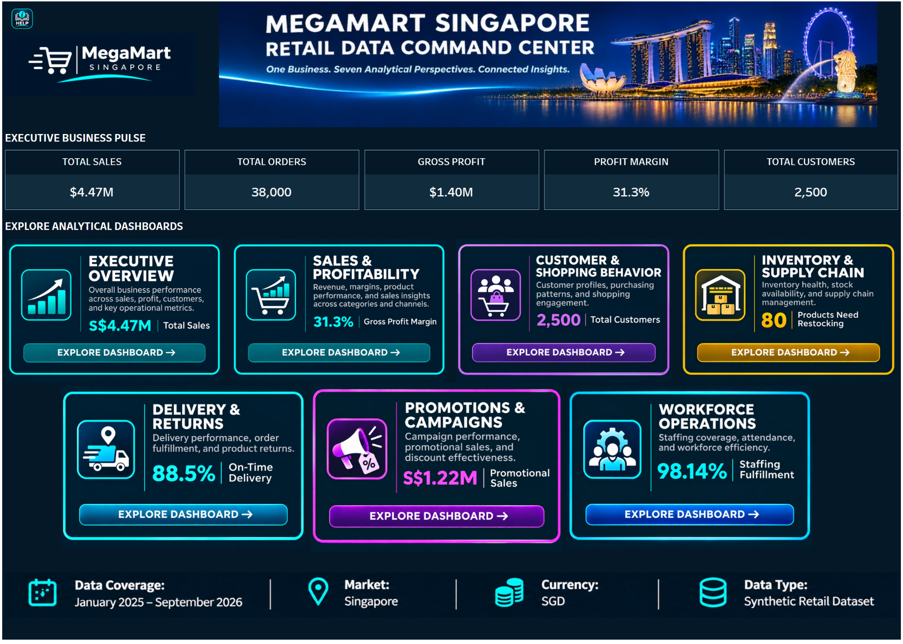

# MegaMart Singapore | Retail Data Command Center

**One Business. Seven Analytical Perspectives. Connected Insights.**

An interactive, Tableau-based retail business intelligence portfolio demonstration using **synthetic Singapore retail data**. The command center provides a single navigation point for executive KPIs and seven connected analytical perspectives, helping business users explore performance and identify questions for further investigation.

**[Explore the interactive Tableau Public dashboard](https://public.tableau.com/app/profile/durga.s1183/viz/RetailDataCommandCenter/DataCommandCenter)**

> **Project scope:** This is a synthetic-data portfolio demonstration, not a live production retail system. Figures illustrate the supplied dataset and should not be interpreted as real company performance.

## At a glance

| Attribute | Details |
|---|---|
| Market | Singapore |
| Data coverage | January 2025 – September 2026 |
| Currency | Singapore dollars (SGD) |
| Platform | Tableau |
| Data | Synthetic retail transactions and operational records |
| Deliverable | Navigable command center with seven analytical dashboards |

### Executive business pulse

| Metric | Dashboard value |
|---|---:|
| Total sales | S$4.47M |
| Total orders | 38,000 |
| Gross profit | S$1.40M |
| Gross profit margin | 31.3% |
| Total customers | 2,500 |

*These are illustrative figures displayed on the command center's landing page; interactive views may change with filters.*

## Business challenge

Retail decisions often require information from different operational functions: sales, customer behavior, inventory, fulfillment, promotions, and staffing. When these areas are analyzed separately, it becomes harder to see the overall business picture and investigate related performance signals.

**Goal:** Bring connected retail KPIs, drill-down views, and consistent navigation into one accessible analytics experience.

## Seven analytical perspectives

| Dashboard | Questions it helps answer |
|---|---|
| **1. Executive Overview** | How is the business performing overall? |
| **2. Sales & Profitability** | Which categories, channels, and periods drive revenue and margin? |
| **3. Customer & Shopping Behavior** | Who shops, where, and how do purchasing patterns differ? |
| **4. Inventory & Supply Chain** | Which products need attention and where are stock risks emerging? |
| **5. Delivery & Returns** | How reliable is fulfillment and what return patterns need investigation? |
| **6. Promotions & Campaigns** | How do campaigns, discounts, and promotional sales perform? |
| **7. Workforce Operations** | How do scheduled hours, actual hours, attendance, and staffing coverage compare? |

The command center also provides navigation and contextual help/glossary information.

## Data and analytics approach

The portfolio demonstrates the following analytical workflow:

1. **Understand source data:** Retail orders and items, customers, products, inventory, deliveries, returns, promotions, and workforce records.
2. **Check quality:** Review types, identifiers, missing values, duplicates, and consistency.
3. **Prepare measures:** Standardize and connect records, define calculations, and validate aggregations.
4. **Model relationships:** Use common business dimensions such as date, product, customer, and location to connect analytical views.
5. **Build Tableau views:** Create KPI cards, charts, filters, dashboard navigation, and contextual explanations.
6. **Verify and refine:** Reconcile metrics, inspect filter behavior, and test navigation and presentation.

This is a **conceptual description of the demonstrated workflow**, not a claim that an automated enterprise ingestion or governance platform was deployed.

## Selected KPI definitions

| KPI | Calculation / interpretation |
|---|---|
| Gross profit margin | `SUM([Gross Profit SGD]) / SUM([Net Sales SGD])` |
| On-time delivery rate | `COUNTD([On Time Delivery Id]) / COUNTD([On Time or Late Delivery Id])` |
| Return rate | `SUM([Return Quantity]) / SUM([Quantity])` |
| Staffing fulfillment | `SUM([Actual Hours]) / SUM([Scheduled Hours])` |
| Staffing gap (hours) | `SUM([Scheduled Hours]) - SUM([Actual Hours])` |
| Attendance rate | `COUNTD([Present Shift Id]) / COUNTD([Shift Id])` |

*Field names above reflect the project's Tableau calculation definitions. Metric interpretation depends on the dashboard's data grain and filters.*

## Example insights and decisions

- **Profitability:** A **31.3% gross profit margin** provides a starting point for exploring the drivers of profitability alongside revenue.
- **Inventory:** **80 products flagged for restocking** can be prioritized for further stock and replenishment review.
- **Delivery:** **88.5% on-time delivery** highlights fulfillment reliability as an area to monitor.
- **Workforce:** **98.14% staffing fulfillment** suggests actual hours are close to scheduled hours, but coverage gaps warrant investigation.
- **Promotions:** **S$1.22M promotional sales** offers a basis for evaluating promotional contribution alongside discounting and margin.

These are **analytical signals**, not proven root causes or measured financial benefits.

## Validation and quality assurance

The project used a build–verify–refine approach: validate KPI definitions and aggregation, reconcile totals across views, review filtering, check navigation, and document metric meaning. Production-grade automation, data-refresh monitoring, and access controls are potential future enhancements rather than implemented features.

## Technology

**Tableau**, calculated fields, interactive dashboard navigation, retail data modeling, KPI design, data quality checks, and business intelligence storytelling.

## Future opportunities — not yet implemented

- Demand forecasting and replenishment recommendations
- Customer segmentation and relevant product recommendations
- Delivery delay and staffing pressure prediction
- Anomaly detection for sales, margin, and returns
- Enterprise-ready refresh pipelines, governance, access controls, and monitoring

These ideas are a **roadmap**, not features already included in the Tableau prototype.

## Explore the project

- **[Open the interactive Tableau Public command center](https://public.tableau.com/app/profile/durga.s1183/viz/RetailDataCommandCenter/DataCommandCenter)**
- **[View the command center screenshot](dashboards/command-center-home.png)**

## Publication note

The Tableau packaged workbook (`.twbx`) includes embedded synthetic CSV datasets and image assets. It is not included in this starter repository package. Review the workbook, data rights, and any embedded metadata before publishing the full packaged workbook or underlying data files.
